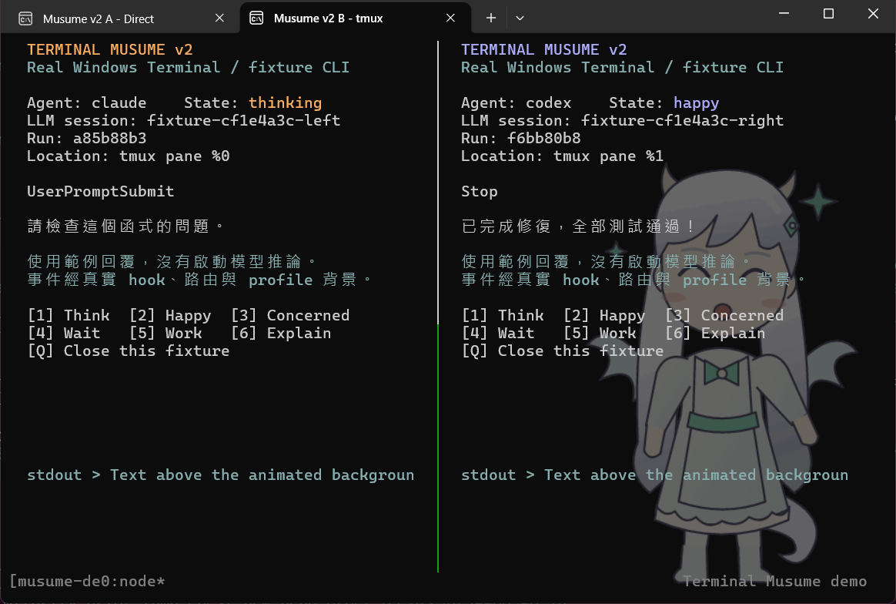
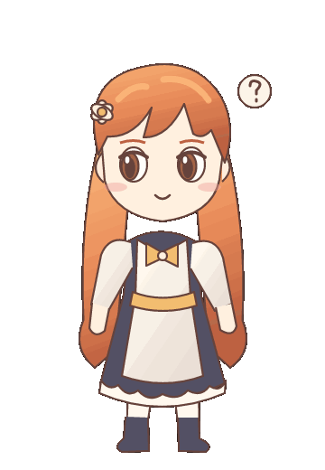
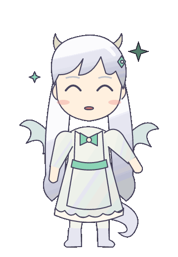

# Terminal Musume

Animated character backgrounds for Windows Terminal that react to Codex and Claude Code sessions. Characters appear behind your terminal text, without taking up a split pane.

This is a working v0.2 prototype for the original Windows Terminal with WSL. It uses native GIF backgrounds and supports independent tabs, local tmux panes, and detach/reattach. The bundled characters are original SVG placeholders; Live2D models and a real-time Live2D renderer are not included.

[](docs/media/demo.webm)

**[Watch the 9-second Windows Terminal demo](docs/media/demo.webm)** · [Animation examples](#reply-and-animation-examples) · [Quick start](#quick-start)

The screenshot and video show real Windows Terminal windows running clearly labeled fixture replies through the actual wrappers, hooks, routing, and background updates. They do not show live model inference or private conversations.

## Requirements

- Windows Terminal, Microsoft Store Stable edition for the default launcher. Native playback was tested on version 1.24.12741.0.
- WSL with Node.js 22 or newer. The native integration was tested on Ubuntu.
- Codex CLI and/or Claude Code installed and signed in **inside WSL** for real sessions.
- tmux for the tmux examples; version 3.4 was tested. Direct tabs work without tmux.

The browser preview and fixture demo do not require an agent account. Prebuilt GIFs are included, so normal use does not require the development graphics or browser tools.

## Quick start

Run these commands inside WSL:

```sh
git clone https://github.com/PAIYUTSUTW/terminal-musume.git
cd terminal-musume
npm ci --omit=dev
```

Try the native Windows Terminal demo:

```sh
npm run demo:windows
```

This opens a dedicated demo profile with the characters behind the text. Press `Space` to pause/resume, `N` for the next step, or `1` through `0` to select a step. Press `Q` or `Ctrl+C` to exit and remove the demo profile.

For a browser-only preview:

```sh
npm start
```

Open <http://127.0.0.1:7331> to choose a character, play animations, and enter sample replies. This mode leaves Windows Terminal and agent settings untouched.

## Example: separate Claude and Codex tabs

From the repository directory in WSL:

```sh
# Each command opens a tab with its own temporary Windows Terminal profile.
node bin/musume.mjs open --provider claude --title 'Claude session'
node bin/musume.mjs open --provider codex --title 'Codex session'
```

Each tab keeps its own character and session state. A completed reply in the Codex tab changes that tab's background independently of the Claude tab.

You can also open a managed shell and use the usual commands inside it:

```sh
node bin/musume.mjs open
# In the new tab:
claude
# Or:
codex
```

Arguments after `--` are forwarded to the agent. For example, replace the directory and model name below with your own:

```sh
node bin/musume.mjs open --provider codex --cwd /path/to/project -- --model YOUR_MODEL
```

The first `open` starts the local controller automatically. Hooks are scoped to each invocation: Claude uses an additional `--settings` file, and Codex uses inline hook configuration. Complete the agent's normal trust review when prompted, including reviewing Codex hook commands before trusting them. The launcher does not install global hooks or bypass trust prompts.

## Example: Claude and Codex in tmux

Create or attach to a local tmux session through a managed tab:

```sh
node bin/musume.mjs open --mode tmux -- new-session -A -s work
```

Inside that tab, run `claude` in one pane and `codex` in another. With the default tmux bindings, use `Ctrl+b` then `%` to split and `Ctrl+b` then an arrow key to select a pane.

- The terminal background follows the selected pane's provider and state.
- A reply from an inactive pane updates its saved state without replacing the visible character.
- Each outer terminal tab has one background, even when tmux contains several splits.

Detach with `Ctrl+b` then `d`. To reattach from another managed tab:

```sh
node bin/musume.mjs open --mode tmux -- attach-session -t work
```

The running agent can continue while detached. Reattaching binds its existing run to the new terminal tab. Routing uses the tmux server socket, server PID, and pane ID rather than a stale `WT_SESSION` inherited by a pane. Multiple clients attached to the same tmux session follow tmux's own window and pane selection behavior.

An existing tmux server or pane may still have its original `PATH`. In the pane where you want to start an agent, load the wrappers for that shell:

```sh
# Replace /path/to/terminal-musume with your checkout directory.
eval "$(node /path/to/terminal-musume/bin/musume.mjs env)"
claude
```

Or invoke the wrapper explicitly:

```sh
node /path/to/terminal-musume/bin/musume.mjs run --provider codex -- --model YOUR_MODEL
```

The outer terminal tab must still be opened through `musume open` so the controller can register its profile and tmux client.

## Reply and animation examples

The default classifier uses inspectable English and Chinese rules. Lifecycle hooks drive thinking and tool activity; completed replies select a reaction.

| Event or example reply | Animation |
| --- | --- |
| A new prompt starts | `thinking` |
| The agent runs a tool | `working` |
| "All tests passed, no errors." | `happy` |
| "Fixed the bug, but 2 tests failed." | `concerned` |
| "Please confirm the next step." | `waiting` |
| "This function validates input before updating the display." | `explaining` |
| No activity, or a reaction finishes | `idle` |

Here are two of the bundled transparent GIFs:

| Claude placeholder: thinking | Codex placeholder: happy |
| :---: | :---: |
|  |  |

There are seven animations per character, 14 GIFs in total, each with 48 frames at 20 FPS. These are original procedural drawings used to demonstrate the integration, not third-party character artwork or Live2D models.

The rules handle some negation and mixed outcomes, but classification can still be wrong. Reactions normally change after a reply finishes; the prototype does not capture the full token stream as it is generated.

## How the background works

Agent hooks send events to a local controller. It tracks runs and conversation sessions, maps them to a direct tab or the selected tmux pane, and updates that tab's profile when the animation changes. Windows Terminal plays the GIF frames natively; the controller only changes the `backgroundImage` path when needed.

Each managed tab gets a separate temporary profile GUID. A single controller serializes settings updates. Closing a managed tab removes its profile; profiles you manually changed are preserved and listed under `preservedProfiles` in the controller status.

```sh
node bin/musume.mjs status
# After closing managed tabs:
node bin/musume.mjs stop
```

The default WSL runtime directory is `~/.local/state/terminal-musume/v2`, or `$XDG_STATE_HOME/terminal-musume/v2` when an absolute `XDG_STATE_HOME` is set. Tokens, event queues, settings backups, and tmux sockets stay outside the checkout. Override the location with `--home` or `TERMINAL_MUSUME_HOME`.

To copy an existing profile's font and colors or adjust the character opacity, set startup options on the first `open`:

```sh
node bin/musume.mjs open --base-profile 'Ubuntu' --opacity 0.45
```

The managed-tab default opacity is 38%, with natural-size images aligned to the bottom right. The controller reuses its startup configuration for later tabs; close managed tabs and stop it before changing the base profile, settings path, pack, or opacity.

## Use your own animation pack

Export the character's actions as transparent GIFs and create a `pack.json` based on [the demo manifest](assets/demo/pack.json):

```text
my-pack/
  pack.json
  claude/
    idle.gif
    happy.gif
  codex/
    idle.gif
    happy.gif
```

```json
{
  "version": 1,
  "name": "My Live2D render pack",
  "sourceKind": "live2d-prerender",
  "providers": {
    "claude": { "idle": "claude/idle.gif", "happy": "claude/happy.gif" },
    "codex": { "idle": "codex/idle.gif", "happy": "codex/happy.gif" }
  }
}
```

Both providers need an `idle` GIF. Supported slots are `idle`, `thinking`, `working`, `happy`, `concerned`, `waiting`, and `explaining`; missing slots fall back to that provider's idle animation. All GIF paths must remain inside the pack directory.

With a fresh controller, open a tab using the pack:

```sh
node bin/musume.mjs open --provider codex --pack /absolute/path/to/my-pack
```

Keep the source and usage terms for any imported artwork. No third-party Live2D models are bundled, and there is currently no exporter that converts `.model3.json` into GIFs. GIF transparency is limited to 1-bit alpha, so rendering against your terminal's background color can improve edge quality.

## Advanced: single-profile bridge

The older `terminal-musume` CLI provides a browser preview attached to a specific Windows Terminal profile. Use `musume open` above for independent sessions; the older mode changes every tab sharing the selected profile.

Open Windows Terminal's JSON settings to find the file in use. Stable, Preview, Canary, and portable editions have different locations. This PowerShell example uses Microsoft Store Stable:

```powershell
$terminalSettings = Join-Path $env:LOCALAPPDATA 'Packages\Microsoft.WindowsTerminal_8wekyb3d8bbwe\LocalState\settings.json'
node bin/terminal-musume.mjs profiles --settings $terminalSettings

# Replace the placeholder with a profile GUID from the output.
node bin/terminal-musume.mjs start --demo --settings $terminalSettings --profile '{YOUR-PROFILE-GUID}'
```

The browser controls now update that profile's native background. `Ctrl+C` restores the appearance fields managed by the bridge, while preserving fields you changed during the run. This mode defaults to 28% opacity and rejects configurations using `useBackgroundImageForWindow`.

For WSL, run the bridge and hooks in the same WSL environment and pass a settings path such as `/mnt/c/Users/YOUR_USER/.../settings.json`. Assets on Windows drives are converted to drive paths; assets in WSL use the distribution's UNC path. Use `--windows-pack-root 'C:\path\to\the\same\pack'` to explicitly name the same pack as Windows sees it.

### Manual hooks and sample replies

These steps are for the older single-profile bridge. The managed-tab launcher already supplies invocation-scoped hooks.

Generate hook fragments in the agent's own environment:

```sh
node bin/terminal-musume.mjs hooks --provider codex
node bin/terminal-musume.mjs hooks --provider claude
```

Merge the generated events into `~/.codex/hooks.json` or `.codex/hooks.json` for Codex, or `~/.claude/settings.json` or `.claude/settings.json` for Claude Code. Preserve existing hooks and settings, complete the native trust review, and start a new session. Use the same `--home` for the bridge and hooks if you override the runtime directory.

With `npm start` running, use a second shell to simulate a completed reply:

```sh
node bin/emit-hook.mjs --provider codex --event Stop --text 'All tests passed, no errors.'
node bin/emit-hook.mjs --provider claude --event Stop --text 'Fixed the bug, but 2 tests failed.'
node bin/emit-hook.mjs --provider codex --event Stop --text 'Please confirm the next step.'
```

Events are queued in the local runtime's `inbox/` and removed after consumption. State snapshots do not retain reply text. Hooks return an empty JSON object and do not rewrite replies, tool arguments, or agent continuation decisions.

### Optional local classifier

The single-profile bridge can use an already-installed local Ollama model:

```sh
node bin/terminal-musume.mjs start --demo --ollama-model YOUR_INSTALLED_MODEL
```

Only reply text is sent to the local Ollama endpoint. The classifier accepts a limited set of reactions and falls back to rules on a 1.6-second timeout, connection failure, or invalid output. The interface has been tested with a mock service; classification quality with a real Ollama model has not been validated. This option is not exposed by the v0.2 managed-tab controller.

## Development and verification

Install development dependencies for tests, asset generation, and browser checks:

```sh
npm ci
npm test
npm run check

# Regenerate the original demo GIFs.
npm run assets

# For browser checks, run npm start in another terminal first.
npx playwright install chromium
npm run test:preview
```

The verified baseline includes 54 automated tests and integrity checks for all 14 GIFs. Tests cover hook subprocesses, event queues, reply classification, JSONC background edits and restoration, session routing, local tmux integration, and runtime storage outside the checkout.

To run the multi-tab/tmux fixture verifier and leave two interactive demo tabs open, use WSL with tmux and FFmpeg supporting MJPEG decoding and VP9 encoding. Close other managed working tabs first. Set `TERMINAL_MUSUME_FFMPEG` to your FFmpeg executable, for example:

```sh
TERMINAL_MUSUME_FFMPEG=/usr/bin/ffmpeg npm run demo:v2
```

In those fixture tabs, press `1` through `6` to select a reaction and `Q` to close a fixture. A detached tmux server remains running, following normal tmux behavior. `npm run record:windows` records an already-running `demo:windows` window and uses the same FFmpeg override; the window is temporarily placed on top during capture.

Native tests on Windows Terminal 1.24.12741.0 confirmed GIF playback, independent tab backgrounds, selected-pane routing, inactive-pane isolation, detach/reattach, and restoration of the original profiles and settings.

Real Codex 0.163.0 sessions were also tested on 2026-10-16, including tool events, success/failure/input reactions, `/new`, and interruption. Claude Code 2.1.285 delivered `SessionStart`, `UserPromptSubmit`, and `StopFailure`; a quota limit prevented validation of a normal completed Claude reply. Fixture demonstrations do not replace that remaining live-session test.

For the opt-in verifier that sends a real Codex request and exercises dedicated test tabs, see [native testing instructions (Chinese)](docs/native-testing.md). Private transcripts, raw recordings, and runtime files are excluded from the repository; only the reviewed [public demo media](docs/media/README.md) are included.

## Current limitations

- The v0.2 launcher supports local WSL sessions and tmux. SSH event forwarding and a native PowerShell session backend are not implemented.
- One outer terminal tab has one background, following the selected tmux pane. Separate backgrounds inside each tmux split are not supported.
- Pre-rendered GIFs provide discrete action changes. Real-time Live2D expression blending, head tracking, and phoneme lip sync are not implemented.
- Windows Terminal settings updates cannot be made atomic across unrelated applications. The controller rereads settings, uses its own lock, and records restoration data, but another settings writer can still race with it.

## License and attribution

The project license has not been selected; `package.json` currently declares `UNLICENSED`. The [MIT proposal](docs/license-proposal.md) and [publication review](docs/open-source-review.md) are available for reference. Bundled fonts and dependencies retain their own licenses; see [THIRD_PARTY_NOTICES.md](THIRD_PARTY_NOTICES.md).

This is an independent community prototype. Codex, Claude, Windows Terminal, and Live2D names identify interoperability targets; no endorsement is claimed.

## References

- [Windows Terminal background settings](https://learn.microsoft.com/en-us/windows/terminal/customize-settings/profile-appearance)
- [Windows Terminal image reload implementation](https://github.com/microsoft/terminal/blob/main/src/cascadia/TerminalControl/TermControl.cpp)
- [Windows Terminal third-party extension tracking issue](https://github.com/microsoft/terminal/issues/4000)
- [Codex hooks documentation](https://learn.chatgpt.com/docs/hooks)
- [Claude Code hooks: Stop and last_assistant_message](https://code.claude.com/docs/en/hooks#stop)
